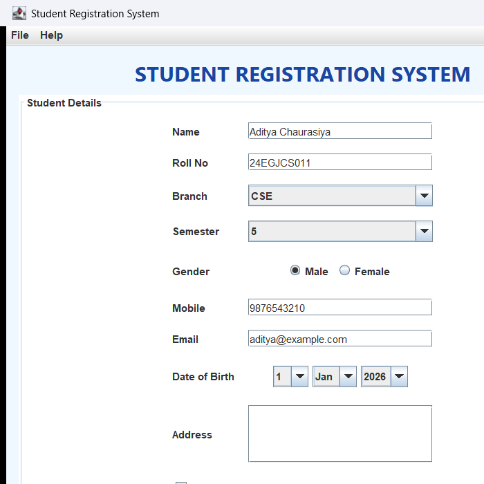
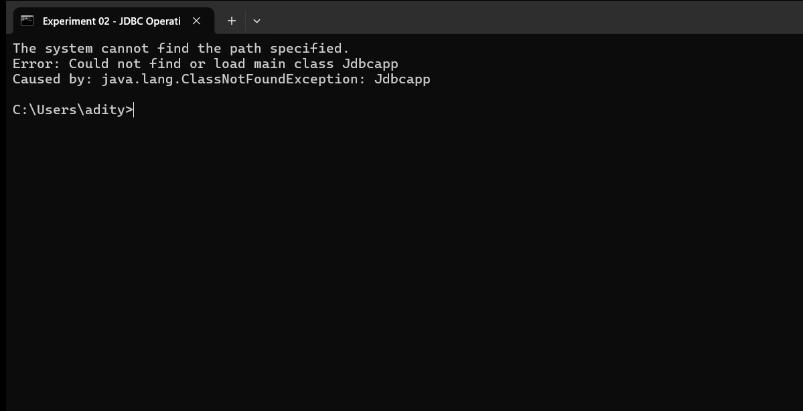
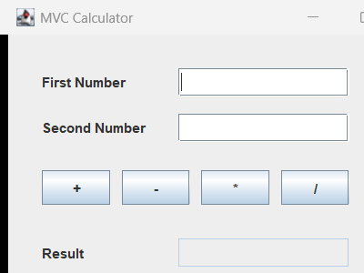
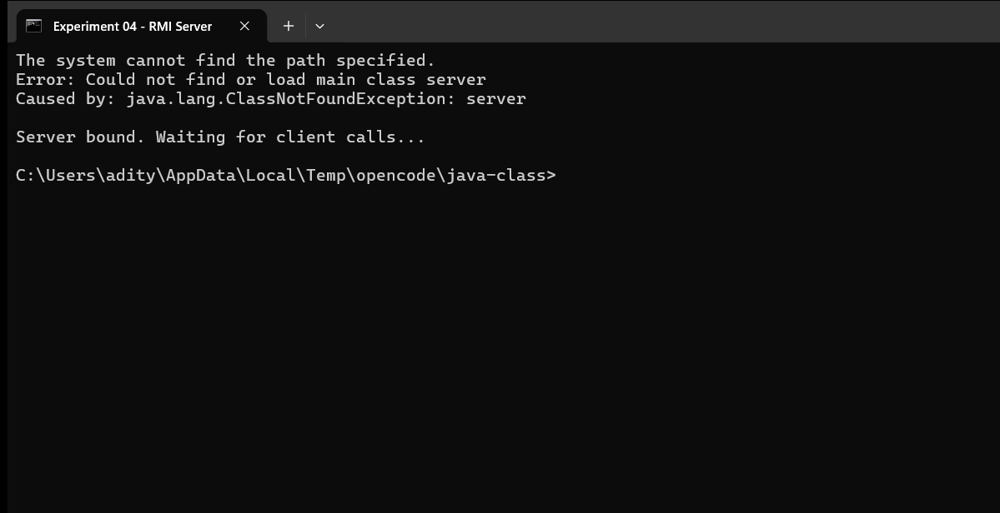
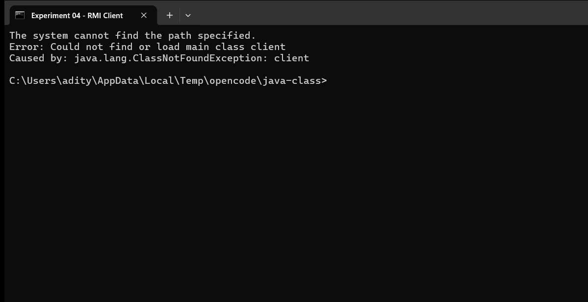
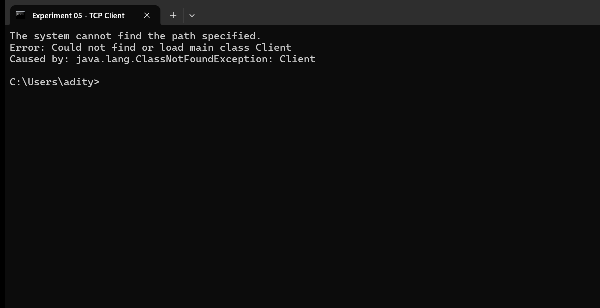
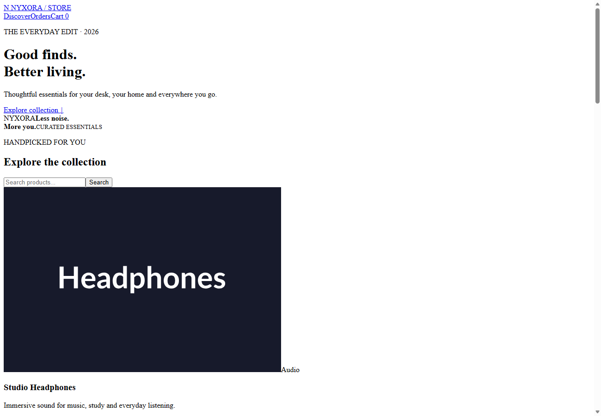

# Java Programming Lab

Practical experiments and a capstone project covering the complete Java programming syllabus — from desktop applications to distributed computing and full-stack web development.

---

## Student Details

| Field | Details |
| --- | --- |
| Name | Aditya Chaurasiya |
| Roll Number | 24EGJCS011 |
| Course | B.Tech |
| Department | Computer Science and Engineering |
| Subject | Java Programming Lab |
| Repository | [java-class](https://github.com/adityachaurasiya0112-code/java-class) |
| GitHub | [adityachaurasiya0112-code](https://github.com/adityachaurasiya0112-code) |

---

## Contents

| No. | Experiment | Technology | Type |
| --- | --- | --- | --- |
| 01 | Student Registration Form | Swing, JDBC, MySQL | Desktop |
| 02 | Database Operations | JDBC, MySQL | Console |
| 03 | MVC Pattern Calculator | Swing, MVC | Desktop |
| 04 | Distributed Calculator | Java RMI | Distributed |
| 05 | Multithreaded Client-Server | Sockets, Threads | Networking |
| 06 | HTTP Request Handling | Jakarta Servlets | Web |
| 07 | Web-Based Student Portal | JSP, Servlets | Web |
| — | E-Commerce Platform | Spring Boot, JPA | Full Stack |

---

## Experiments

### Experiment 01 — Student Registration Form

A desktop application built with Java Swing that collects student details and stores them in a MySQL database.

**Details**

- Form fields: name, roll number, branch, semester, gender, mobile, email, date of birth and address
- Branch and semester are provided as dropdown menus to avoid invalid entries
- Input validation before saving, including numeric roll number and required terms acceptance
- Records are inserted into the `students` table using a `PreparedStatement`
- Buttons provided: Submit, Preview, Reset and Exit

**Files**

```
Experiment-01-Registration-Form-Using-Java/
├── StudentRegistrationSystem.java
└── student_database.sql
```

**How to run**

```bash
# Create the database schema
mysql -u root -p < Experiment-01-Registration-Form-Using-Java/student_database.sql

# Compile and run
cd Experiment-01-Registration-Form-Using-Java
javac -cp ".:mysql-connector-j-9.5.0.jar" StudentRegistrationSystem.java
java -cp ".:mysql-connector-j-9.5.0.jar" StudentRegistrationSystem
```

**Screenshot**



---

### Experiment 02 — Database Operations with JDBC

A console application demonstrating complete database operations using JDBC.

**Details**

- Creates the `college` database and `students` table automatically on first run
- Interactive menu for inserting and displaying student records
- Demonstrates the complete JDBC flow: loading the driver, connecting, executing queries and closing resources
- Uses try-with-resources so that connections and statements are always closed correctly

**How to run**

```bash
cd Experiment-02-Database-Operations-With-JDBC
mvn compile exec:java -Dexec.mainClass=Jdbcapp
```

**Screenshot**



---

### Experiment 03 — MVC Pattern Calculator

A calculator application that demonstrates the Model-View-Controller design pattern using Java Swing.

**Structure**

| Layer | File | Responsibility |
| --- | --- | --- |
| Model | `CalculatorModel.java` | Arithmetic operations — addition, subtraction, multiplication, division |
| View | `CalculatorView.java` | User interface with text fields and operation buttons |
| Controller | `CalculatorController.java` | Handles user events and coordinates between model and view |
| Entry point | `Main.java` | Creates and connects all three components |

The three layers are independent of each other. The model contains no user interface code, and the view contains no business logic.

**How to run**

```bash
cd Experiment-03-MVC-Pattern-Based-Calculator
javac Main.java CalculatorModel.java CalculatorView.java CalculatorController.java
java Main
```

**Screenshot**



---

### Experiment 04 — Distributed Calculator using RMI

A distributed application that allows a client to call methods on a server object running in a different Java Virtual Machine.

**Files**

| File | Purpose |
| --- | --- |
| `calculator.java` | Remote interface defining the methods available on the server |
| `server.java` | Implements and binds the remote object to the RMI registry |
| `client.java` | Looks up the remote object and invokes its methods |
| `CalculatorImple.java` | Implementation of the remote interface |

**How to run**

```bash
cd Experiment-04-Distributed-Calculator-Using-RMI
javac calculator.java server.java client.java CalculatorImple.java

# Terminal 1
rmiregistry &
java server

# Terminal 2
java client
```

**Screenshots**





---

### Experiment 05 — Multithreaded TCP Client-Server

A TCP server that handles multiple clients simultaneously using threads.

**Details**

- Server listens on port 5000 using `ServerSocket`
- A new thread is created for every client that connects
- Each client connection has its own input and output streams
- Server echoes each received message back to the client
- Client types `exit` to end the connection

Because each client runs in a separate thread, one slow or idle client does not block the others.

**How to run**

```bash
cd Experiment-05-Multithreaded-TCP-Client-Server
javac Server.java Client.java

# Terminal 1
java Server

# Terminal 2
java Client
```

**Screenshots**




---

### Experiment 06 — HTTP Request Handling with Servlets

A web application demonstrating HTTP request handling using Jakarta Servlets.

**Servlets**

| Servlet | Mapping | Purpose |
| --- | --- | --- |
| `HelloServlet` | `/hello` | Returns a simple HTML response |
| `HomeServlet` | `/home` | Serves the landing page |
| `LoginServlet` | `/login` | Creates a user session |
| `LogoutServlet` | `/logout` | Destroys the user session |
| `StudentServlet` | `/student` | Reads form data from a POST request |

**Filters and Listeners**

- `AuthFilter` blocks unauthenticated requests before they reach a servlet
- `LoggingFilter` records every incoming request
- `SessionListener` and `AppListener` handle session and application lifecycle events

**How to run**

```bash
cd Experiment-06-HTTP-Request-Handling-With-Servlets
mvn clean package
```

The build produces `target/servlet.war`, which can be deployed to any Jakarta Servlet 6.x container.

**Screenshots**

Login page served at `/servlet/`:


`HelloServlet` response at `/servlet/hello`:


---

### Experiment 07 — Web-Based Student Portal

A complete web application following the MVC pattern, combining Servlets with JSP.

**Details**

- Servlets handle request processing and business logic
- JSP pages — `student.jsp` and `result.jsp` — handle presentation
- Data is transferred from servlet to JSP using `request.setAttribute()`
- Authentication filter and session listener provide access control

```
Browser  ->  Servlet (Controller)  ->  JSP (View)  ->  Response
```

**How to run**

```bash
cd Experiment-07-Web-Based-Student-Portal/jsp-servlet-student-main
mvn clean package
mvn org.apache.tomcat.maven:tomcat7-maven-plugin:run
```

**Screenshots**

Portal login page:


`student.jsp` — JSP view of the portal:


---

## Capstone Project — E-Commerce Platform

A complete online store built with Spring Boot that combines all the concepts learned throughout the laboratory course.

**Technology**

| Layer | Technology Used |
| --- | --- |
| Web framework | Spring Boot 3.4.5 |
| User interface | Thymeleaf templates |
| Database access | Spring Data JPA |
| Database | H2 in-memory |
| Domain model | Product entity with name, category, price, description and stock |

**Details**

- `StoreController` handles all store routes — product listing, cart and orders
- `ProductRepository` provides database access through JPA without writing SQL
- `Product` is mapped as a JPA entity
- H2 database requires no separate installation and is seeded automatically on startup
- Three Thymeleaf templates render the store, cart and order pages

**How to run**

```bash
cd Java-Project-E-Commerce-Platform
mvn spring-boot:run
```

Then open `http://localhost:8080` in a browser.

**Screenshot**



---

## Project Structure

```
java-class/
├── Experiment-01-Registration-Form-Using-Java/
├── Experiment-02-Database-Operations-With-JDBC/
├── Experiment-03-MVC-Pattern-Based-Calculator/
├── Experiment-04-Distributed-Calculator-Using-RMI/
├── Experiment-05-Multithreaded-TCP-Client-Server/
├── Experiment-06-HTTP-Request-Handling-With-Servlets/
├── Experiment-07-Web-Based-Student-Portal/
├── Java-Project-E-Commerce-Platform/
└── README.md
```

---

## Requirements

| Software | Version | Required For |
| --- | --- | --- |
| JDK | 17 or later | All experiments |
| Apache Maven | 3.8 or later | Experiments 02, 06, 07 and the capstone project |
| MySQL | 8.0 or later | Experiments 01 and 02 |
| Servlet Container | Tomcat 10 or later | Experiments 06 and 07 |

**Note:** Experiments 01 and 02 expect a MySQL server running on `localhost:3306` with username `root` and password `1234`. These values are defined as constants at the top of the source files and can be changed to match your environment.

---

## Cloning the Repository

```bash
git clone https://github.com/adityachaurasiya0112-code/java-class.git
cd java-class
```

Each experiment folder is self-contained. Navigate into any folder and follow the steps given in its section above.

---

## Concepts Covered

| Concept | Experiment |
| --- | --- |
| Object-oriented programming | All experiments |
| Event handling and GUI development | Experiments 01, 03 |
| Model-View-Controller architecture | Experiments 03, 07 |
| Database connectivity using JDBC | Experiments 01, 02 |
| Distributed computing using RMI | Experiment 04 |
| Multithreading and networking | Experiment 05 |
| HTTP request handling | Experiment 06 |
| Dependency injection and ORM | Capstone project |

---

## Future Improvements

- Add a separate README file inside every experiment folder
- Add unit tests using JUnit for the calculator and database layers
- Move database credentials to environment variables
- Add Docker support for the capstone project

---

## Author

**Aditya Chaurasiya**

Roll Number: 24EGJCS011
B.Tech — Computer Science and Engineering
GitHub: [adityachaurasiya0112-code](https://github.com/adityachaurasiya0112-code)

---

## License

This repository is intended for educational and academic purposes. Reuse and redistribution should follow the permissions and licenses of the original dependencies used.
